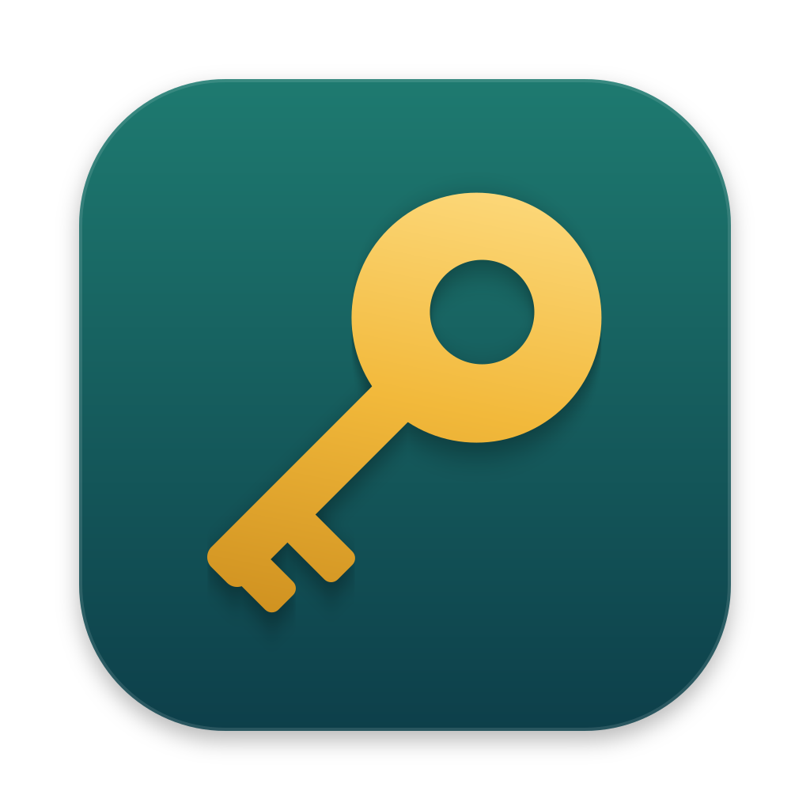
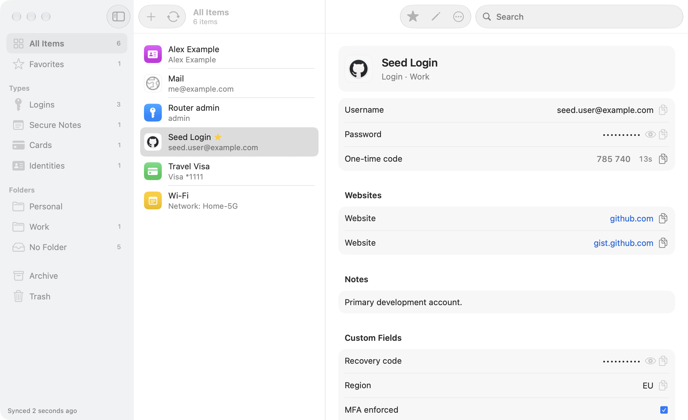

<p align="center"></p>

# Keywarden

**A native, free and open-source Bitwarden-compatible client for macOS.**

Keywarden implements most, but not all, of the official Bitwarden client's functionality. It connects to Bitwarden cloud or self-hosted servers, with menu-bar access and Touch ID unlock for the official browser extension.

<picture>
  <source media="(prefers-color-scheme: dark)" srcset="docs/screenshots/window-dark.png">
  
</picture>

## The vault, without the browser

Open the window and search is already focused. Find an item, copy a password or one-time code, get back to work. Arrow keys move between search results and copyable fields; direct shortcuts handle the common actions.

Logins, cards, identities, notes, SSH keys, bank accounts, driver's licenses and passports. Live one-time codes, passkey details, custom fields, attachments and password history alongside the item.

## Touch ID for both

Unlock Keywarden with Touch ID, a local PIN or your master password. Let the Bitwarden extension request its own Touch ID approval—even while the app's vault stays locked.

Firefox, Zen, Chrome, Edge, Brave, Arc, Vivaldi, Opera and other supported Chromium browsers. Connections are managed in Settings, with the previous native host restored on disconnect.

## Features

- **Manage:** create, edit and clone items; folders, favorites, archive and trash. Conflicting saves retain the draft and leave remote changes intact.
- **Generate:** passwords, usernames and email-forwarding aliases, with in-memory history.
- **Transfer:** Bitwarden JSON, CSV and encrypted JSON, with an import preview.
- **Stay available:** encrypted offline cache, background operation and launch at login.
- **Make it yours:** menu-bar or Dock presence, session policies, clipboard clearing and 36 interface languages.

SwiftUI on the surface, Bitwarden's Rust SDK underneath. Credentials and Touch ID-protected keys live in the macOS Keychain.

[Keyboard & search](docs/usage.md) · [Browser connection](docs/browser-touch-id.md) · [Security](docs/security.md)

## Install

```sh
brew install --cask fogrye/tap/keywarden
```

Requires macOS 26+ and Apple Silicon. Or [download the latest release](../../releases/latest) and install in `/Applications` for a stable browser-host path.

Releases are Developer ID-signed and notarized. [Build from source](CONTRIBUTING.md).

Update with `brew upgrade --cask keywarden`, or replace the app if installed manually. Disconnect browsers in Settings › Browsers before uninstalling.

<details>
<summary>Verify release provenance</summary>

```sh
gh attestation verify Keywarden-*.zip --repo fogrye/keywarden
```

</details>


## Not affiliated with Bitwarden

Keywarden is a personal, non-commercial project. Bitwarden is a trademark of Bitwarden, Inc., which does not endorse or support this app. The name appears only to describe compatibility, including the host name `com.8bit.bitwarden`. The license covers the code, not names or logos.

## License

Copyright © 2026 Keywarden contributors. [GPL-3.0-only](LICENSE); contributions are accepted under the same license. The GPL conflicts with the App Store's terms.

- **Bitwarden SDK:** used under its GPL-3.0 option, with none of the `bitwarden_license/` crates.
- **Translations:** many are from the Bitwarden clients (Crowdin, GPL-3.0). The rest are AI-translated and marked *needs review* in `Sources/Keywarden/Localizable.xcstrings`.
- **Other dependencies:** permissive licenses and one MPL-2.0 crate. Notices are in [`ThirdPartyLicenses.txt`](Sources/Keywarden/ThirdPartyLicenses.txt); `scripts/third-party-licenses.sh` regenerates it.
